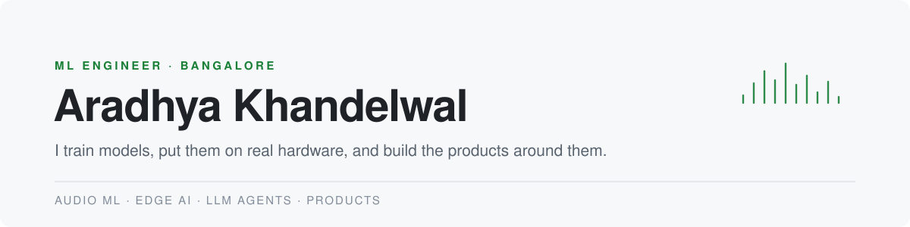

<picture>
  <source media="(prefers-color-scheme: dark)" srcset="assets/header-dark.svg">
  
</picture>

  <a href="https://aradhya-khandelwal.vercel.app">Portfolio</a> &nbsp;·&nbsp;
  <a href="https://scholar.google.com/citations?user=He4BME4AAAAJ">Google Scholar</a> &nbsp;·&nbsp;
  <a href="https://www.linkedin.com/in/aradhya-khandelwal281/">LinkedIn</a> &nbsp;·&nbsp;
  <a href="mailto:arukhandelwal281@gmail.com">arukhandelwal281@gmail.com</a>

### Now

**Deep Learning Trainee, SSS Defence.** Acoustic drone detection on a multi-microphone array: synthetic data, sim-to-real training, CUDA signal processing and real-time deployment on NVIDIA Jetson. Code is private.

**Co-founder, [Ortrovert](projects/ortrovert-llm-flow.md).** The multi-agent LLM platform behind our AI marketing service, in production with paying clients. Private repo; the page shows the architecture.

**Building [Air Drums](projects/virtual-drumkit.md).** Drumsticks with motion sensors, played in the air. Orientation tracking works; turning hits into drum sounds is next.

 

### Work

**Audio and speech**
- **[Earmark](https://github.com/arukh281/EarMark)**: keeps only your voice, so a voice agent isn't cut off by a TV or its own echo. Runs live in the browser.
- **[desi-tts](https://github.com/arukh281/desi-tts)**: an open TTS model fine-tuned on my voice to speak Indian English, Hindi and Hinglish.

**LLM agents**
- **[Ortrovert](projects/ortrovert-llm-flow.md)**: company audit, then a planner, 7 writer agents and a critic, with cost tracking per call. private
- **[Hypercharge](https://github.com/arukh281/Hypercharge-)**: persistent memory, a code graph and safety hooks for Claude Code and Cursor agents.

**Vision and edge**
- **[Aerial Truck Detection](projects/aerial-truck-detection.md)**: finding tiny trucks in overhead photos with YOLO11, tiling and error analysis. private
- **[Sensor Anomaly](https://github.com/arukh281/sensor-anomaly)**: anomaly detection on NASA turbofan sensors, served with FastAPI.

**Products**
- **[Tour With Me CRM](projects/tour-with-me-crm.md)**: lead CRM and phone app for a 4x4 tour operator, live with real leads. private
- **[Review Insights](https://github.com/arukh281/review-insights)**: LLM review analytics with Google Business Profile sync.
- **[SwiftShare](https://github.com/arukh281/SwiftShare)**: anonymous encrypted file sharing; the basis of my ICDSA paper.

 

### Built for friends and family

[Bairagi Films](https://bairagifilms.com) · [Ortrovert](https://www.ortrovert.com) · [C.M. International](https://cminternational.vercel.app) · [Ayati Group](https://ayati-six.vercel.app) · [Rango's Bakes](https://rangos-bakes.vercel.app) · [Vendor Ledger](https://github.com/arukh281/ledger), a tally app for my father's business

In progress: [BAMA Group](https://bamagroup.in) · [Bloqcube](https://bloqcube.com)

 

### For fun

**[Air Drums](projects/virtual-drumkit.md)**, drums you play in the air · **Claude Counter**, a mic array that counts every time the office says "Claude", in Hinglish

 

### Publications

**Unsupervised Approach for Classifying Volume Scattering for Surface Roughness and Potential Water-Ice Deposits** 
IEEE InGARSS 2025 · [IEEE Xplore](https://ieeexplore.ieee.org/abstract/document/11583820/)

**Beyond Nonce Uniqueness: A Cryptographic Evaluation of AES-GCM in Secure Anonymous File Sharing Systems** 
ICDSA 2025, first author · [Springer](https://doi.org/10.1007/978-3-032-15407-1_26)

**Secure anonymous file sharing** 
Indian patent application 202511066102 A, published Jul 2025

 

Python · PyTorch · CUDA · NVIDIA Jetson · C++ · WebAssembly · FastAPI · PostgreSQL · LLM agents · TypeScript · React · Next.js · Docker · AWS
