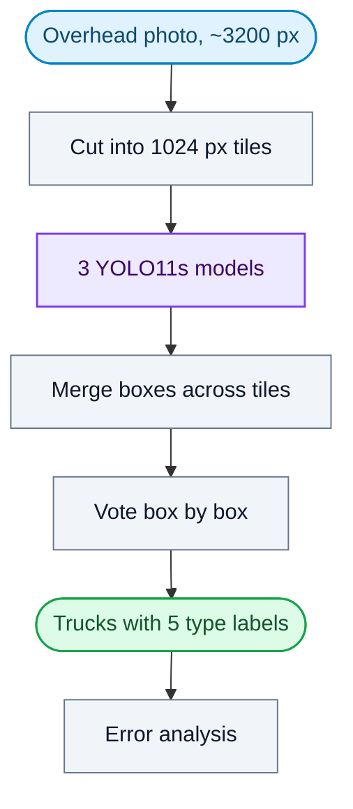

# Aerial Truck Detection

*Finding and naming tiny trucks in overhead satellite photos.*

> Private work. The code isn't public, but this is the work I did on it.

## What it does

It finds trucks in large overhead photos and sorts each one into five types: cargo, box, flatbed, tractor and liquid tanker. The photos are about 3,200 × 2,900 pixels, and a typical truck is only about 22 pixels long. The final system is three YOLO11s models voting, and it was chosen on a held-back practice set, not on the test.

## How it works

- **Tiling at full resolution:** shrinking the photo to 640 px turns a truck into a few dots. Overlapping tiles keep it visible, and this was the biggest single gain (0.0020 to 0.0715 mAP50).
- **Merging:** predictions from overlapping tiles are mapped back to the full photo and duplicates are removed.
- **Voting:** three models' answers are combined box by box into one final set.
- **Error analysis:** each kind of mistake (wrong type, false alarm, missed truck, loose box) is costed by how much fixing it would raise the score.

## What I built

- A tiling and merging library for sliced training and inference on large images.
- The full train, evaluate and predict pipeline, with one config file per experiment.
- A TIDE-style breakdown of errors, which showed that naming the wrong type costs the most (+0.147 if fixed, against +0.022 for loose boxes).
- More than a dozen controlled experiments, each changing one thing and with its prediction written down before the run.
- Known-answer tests for scoring, tiling and the analysis code.
- Honest reporting: the target was 0.75 and the final system scored 0.1349 mAP50 on the 22-photo test, reproduced exactly in a clean environment. The writeup explains why the model, trained on 403 photos, finds trucks far better than it names their type.

## Stack

Python · PyTorch · Ultralytics YOLO11 · NumPy · pytest · Kaggle T4 / Colab
