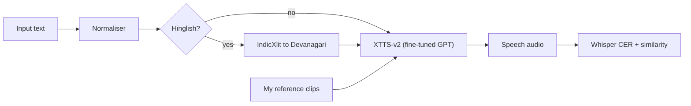

# desi-tts

*An open TTS model fine-tuned on my own voice to speak Indian English, Hindi and Hinglish.*

> Public repository: [github.com/arukh281/desi-tts](https://github.com/arukh281/desi-tts)
>
> Status: finished (October 2026). Indian names are still its weak spot.

## What it does

It turns text in Indian English, Hindi or Hinglish into speech in my voice. I fine-tuned XTTS-v2 on 24 minutes of my own recordings. On an 88-sentence benchmark, Hinglish character error rate (a rough score) fell from 0.400 to 0.098, and speaker similarity rose from 0.502 to 0.730 (my real voice scores 0.763).

## How it works

- The normaliser writes numbers, ₹, dates and acronyms out as words.
- Hinglish is sent to the model in Devanagari, using IndicXlit.
- The GPT part of XTTS-v2 is fine-tuned on my recordings, and the checkpoint is picked on validation data only.
- Every model is scored the same way: Whisper large-v3 CER and speaker similarity over 3 seeds, with bootstrap confidence intervals.

## What I built

- I recorded the dataset myself: a Mac recording tool, recording sessions and reference clips.
- I built a data-prep pipeline with clip checks, cleaning, a Whisper transcript check, the train/val split and a dataset card.
- I froze an 88-sentence benchmark with held-out Hinglish, names and long-sentence sets.
- I ran the fine-tuning experiments on a free Kaggle T4 through a runner that pins each run to an exact commit.
- I wrote the eval: CER, similarity, 3-seed runs, bootstrap tests and an error analysis. Overall CER went from 0.125 to 0.061.
- I profiled serving: a 1.8 GB model using 2.5 GB of GPU memory, a real-time factor of 0.51, and first streamed audio after 0.43 s.
- The results tables that need no private audio rebuild from the repo with one script, no GPU needed.

## Stack

Python · PyTorch · Coqui XTTS-v2 · Whisper large-v3 · IndicXlit · Kaggle T4 · pytest
