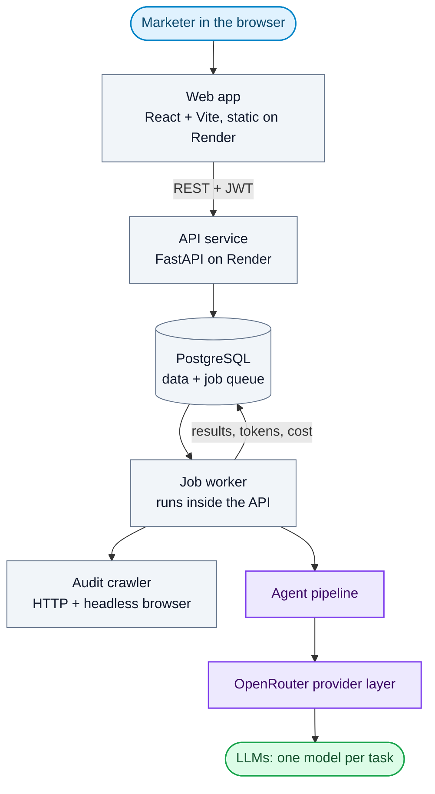
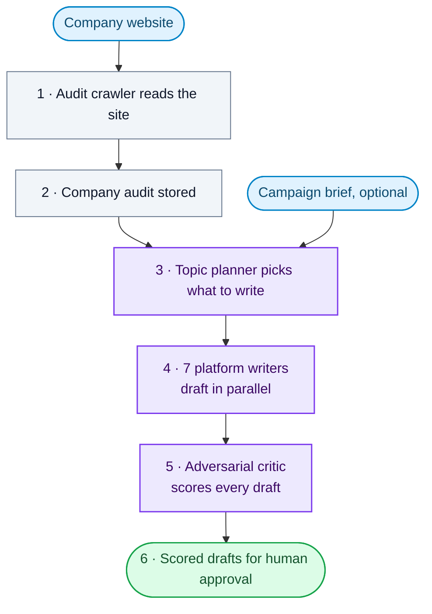

# Ortrovert (The Algorithm Lab)

*A multi-agent LLM platform that audits a company's website and turns it into platform-ready content.*

> Private repository. The code isn't public, but this is the work I did on it.

## System architecture

- **Two services:** a static React app and a FastAPI API. The API runs its database migrations on boot.
- **No separate queue server:** jobs live in PostgreSQL. A worker loop inside the API claims them with `SELECT … FOR UPDATE SKIP LOCKED`, so long LLM runs never block a web request.
- **Multi-tenant:** every row is scoped to a tenant, and users log in with JWT (API keys for scripts).

## What happens when you add a company

1. **Audit.** The crawler fetches the company's pages (with SSRF guards), falling back to a headless browser for JavaScript-heavy sites, and extracts what the business does.
2. **Store.** The audit is saved once in PostgreSQL and becomes the shared context for every agent after it.
3. **Plan.** A topic agent decides what to write from the audit. If a campaign is active, its brief (built by the directions, Bible, arc and atomize agents) steers every topic.
4. **Write.** Blog, LinkedIn, Twitter, Reddit, Medium, Quora and Bluesky agents draft in parallel through one orchestrator.
5. **Critique.** A critic on a different model from the writers scores each draft, flags generic openers, unexplained jargon and unsourced claims, and keeps a rejection history.
6. **Approve.** Drafts arrive in the web app, scored, for a person to review.

## Keeping it reliable

- **One model per task:** the provider layer routes each kind of work to its own model through OpenRouter, and checks at startup that every model exists and has a price.
- **Cost tracking:** every call records its tokens, including prompt-cache reads and writes, and its cost in exact decimal maths.
- **Jobs that survive crashes:** worker heartbeats, retries, requeueing of stuck jobs and cleanup of orphaned runs.
- **Tested:** 594 automated tests, run in CI on every push.

## Stack

Python · FastAPI · PostgreSQL · Alembic · OpenRouter · Playwright · React · Vite · Docker · Render
