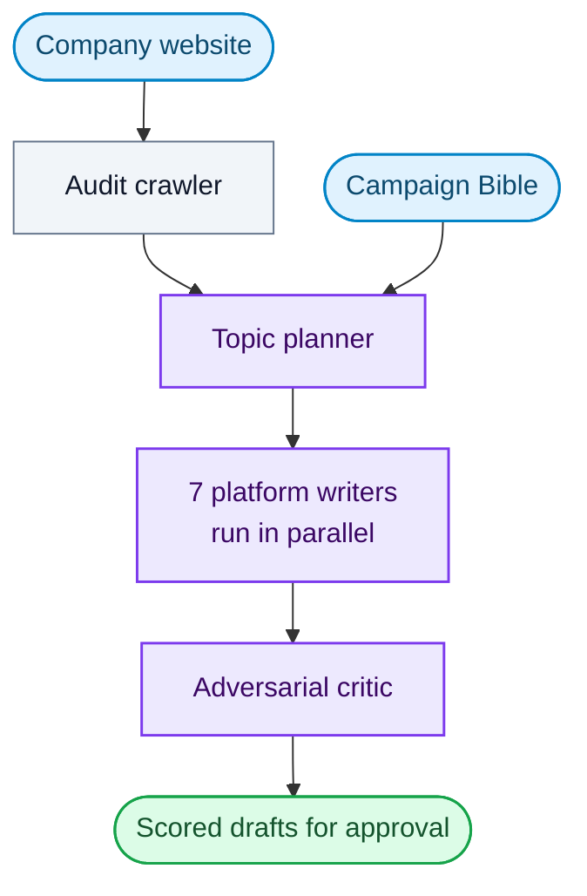

# Ortrovert (The Algorithm Lab)

*A multi-agent LLM pipeline that turns a company audit into platform-ready content.*

> Private repository. The code isn't public, but this is the work I did on it.

## What it does

Ortrovert audits a company's website, plans topics from what it finds, and writes native posts for seven platforms in parallel. A separate critic model reviews every draft before it reaches a human. Campaigns add a planning layer so all content follows one shared brief.

## How it works

- **Audit and plan:** a crawler reads the site, then a topic agent plans what to write from the audit context.
- **Write:** blog, LinkedIn, Twitter, Reddit, Medium, Quora and Bluesky agents draft in parallel through one orchestrator.
- **Critique:** a critic agent, run on a different model from the writers, scores each draft and flags generic openers, unexpanded jargon and unverified claims.
- **Campaigns:** directions, Bible, arc and atomize agents build one campaign brief that governs every generation for that client.

## What I built

- The agent pipeline: audit crawler, topic planner, seven platform writers and the orchestrator that routes and aggregates them.
- An adversarial critic pass with rejection history, kept on a separate model so writers don't grade their own work.
- The campaign engine (directions, Bible, arc, atomize) that keeps a whole campaign on one brief.
- An OpenRouter provider layer with per-workload model routing (Anthropic models for creative writing and visual audit, other vendors for ingestion, strategy and critique), and a startup check that every model slug exists and is priced.
- Per-call token and cost tracking, including prompt-cache reads and writes, with exact decimal maths.
- A Postgres job queue using `SELECT ... FOR UPDATE SKIP LOCKED`, with heartbeats, stuck-job requeue and orphan cleanup.

## Stack

Python · FastAPI · PostgreSQL · Alembic · OpenRouter · Playwright · React · Vite · Render
