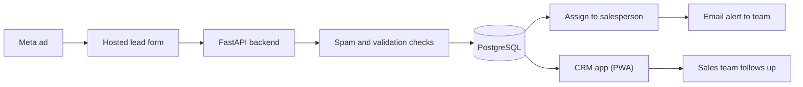

# Tour With Me CRM

*A lead CRM for a 4x4 tour operator in India, from the ad click to the sales call.*

> Private repository. The code isn't public, but this is the work I did on it.

**Status:** Phase 1 and Phase 2 complete, with a self-hosted deploy setup.

## What it does

Leads from the operator's ads land on a form we host, not inside Meta. Each lead becomes a contact in the CRM, tagged with the campaign it came from and assigned to a salesperson. The team gets an email alert and works the lead from a phone-friendly app.

## How it works

- The ad links to the hosted form with a campaign tag in the URL, so every lead keeps its source.
- The backend checks each submission, records consent, and saves or updates the contact in PostgreSQL.
- New leads are assigned and the team is alerted by email; background jobs run on Celery and Redis.
- Sales staff open the lead in an installable app and reach the customer with a WhatsApp link.

## What I built

- The FastAPI backend: contacts, forms, campaigns, statuses, tags, CSV import and export, users.
- The public hosted form with spam checks, per-IP rate limiting and repeat-submission handling.
- Campaign attribution, so each contact shows which ad brought it in.
- Two roles, owner and sales, with sales staff scoped to their own leads.
- A Next.js PWA with a phone-first UI for the sales team.
- Meta lead ingestion and a WhatsApp notifier, both kept behind config flags.
- A backend test suite covering auth, forms, scoping, migrations and security hardening.

## Stack

Python · FastAPI · SQLAlchemy · Alembic · PostgreSQL · Celery · Redis · Next.js · TypeScript · Tailwind
