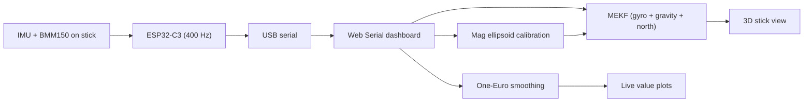

# Air Drums

*Drumsticks with motion sensors, played in the air: the early sensing and orientation stage.*

> Work in progress. Code not public yet.

## What it does

A DIY air drum kit. Each stick carries an IMU and a magnetometer on an ESP32-C3. The aim is to work out where each stick points and when it strikes, then play the right drum. So far the stick streams raw data to a browser dashboard that tracks its 3D orientation live.

## How it works

- The firmware reads accel and gyro at 400 Hz (±16 g, ±1000 dps) and the magnetometer at 30 Hz, each line tagged with a board timestamp (latest sketch; the board still runs an older 50 Hz build).
- An ellipsoid fit removes hard- and soft-iron distortion from the magnetometer; the result is saved in the browser.
- A 6-state error-state Kalman filter (attitude + gyro bias) predicts with the gyro, then corrects roll and pitch from gravity and yaw only from the magnetic heading.
- The gravity correction is skipped when acceleration is more than 0.25 g away from 1 g, so swings and hits don't corrupt the attitude.

## What I built

- Arduino sketches to scan the I2C bus and stream raw IMU and magnetometer readings over serial.
- A single-page Chrome dashboard (Web Serial + three.js) showing raw and smoothed values and a live 3D stick.
- The magnetometer calibration: a least-squares ellipsoid fit giving per-axis offset and scale.
- The orientation filter, with gyro-bias estimation, a gate on the accelerometer during hits and rejection of disturbed magnetometer readings.
- Node test scripts: one checks the ellipsoid fit, one runs the filter on a simulated 60 s motion with gyro bias and noise.
- A full spec for the next stage: a Mac pipeline for parsing packets, hit detection, drum zones, kick and hi-hat pedal, and MIDI output.

## Stack

ESP32-C3 · Arduino · MPU-6500 · BMM150 · JavaScript · Web Serial · three.js · Node.js
